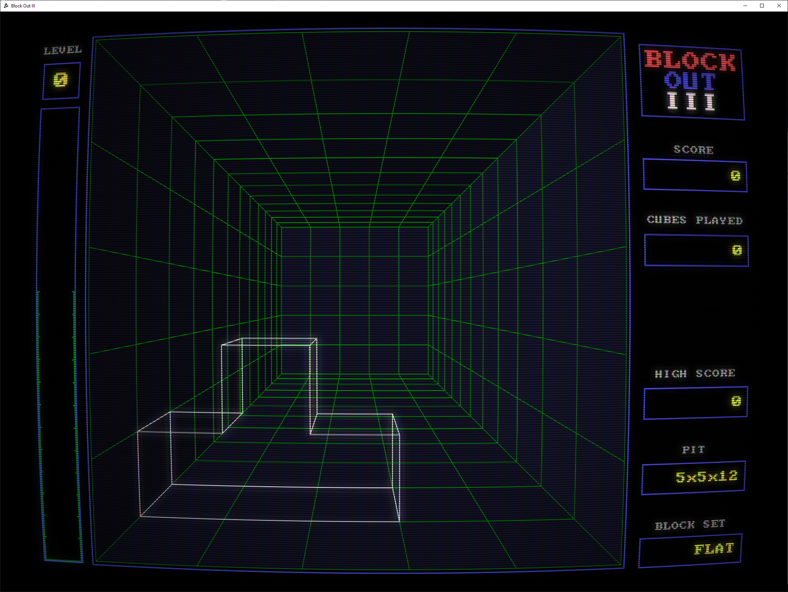

# Block Out III

A Windows 10/11 port of **BlockOut II 2.5** by Jean-Luc Pons, itself a faithful
remake of the 1989 DOS game *Blockout* (California Dreams). Same rules, same
scoring, original 80s look, Direct3D 11, sharp up to 2160p. Offline only.
One EXE, no data files: graphics, font and sounds are generated by the program.

## Build

Visual Studio 2022 (or its Build Tools) with the C++ workload, CMake and Ninja:

    .\build.ps1 -Test

or from a plain command prompt (same options: `test`, `debug`, `clean`):

    src\build.bat test

`build\Release\BlockOut3.exe` is the game; `regress.exe` checks that the game
logic still plays exactly like the original BlockOut II code (in `reference/`).

## Data

Settings and high scores live in `%LOCALAPPDATA%\Block Out III`. On the first
start the BlockOut II setup and high scores (`%LOCALAPPDATA%\Blockout`) are
taken over; the BlockOut II files are not modified.

## Licence

GNU General Public License version 3 or later, see `LICENSE`.
BlockOut II is © Jean-Luc Pons, GPL version 2 or later.
